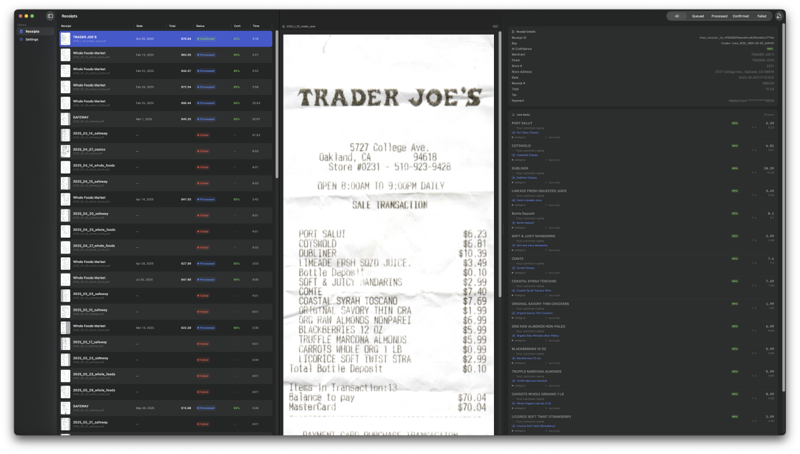

<p align="center">
  
</p>

<h1 align="center">Rhea</h1>
<p align="center">A study in AI-assisted development — a receipt-scanning app built entirely through conversation with Claude.</p>

<p align="center">
  macOS 14+ · runs fully local · archived
</p>

---

> **Archived.** Rhea was a deliberate experiment in AI-assisted software development.
> It was designed, specified, and written primarily through conversation with Claude.
> The code is functional but rough — it's a case study, not a product.
> Don't rely on it as your only copy of receipt data.

Drop in receipt PDFs, review each extraction next to the original scan, confirm it,
and export to CSV or Postgres. Extraction runs against your own local vision model
(LM Studio, oMLX, or anything else that speaks the OpenAI chat-completions API) —
nothing leaves your machine.

This project demonstrates what's possible when a developer iterates closely with an
AI coding assistant over the course of a project — from architecture decisions to
bug fixes to feature additions, all through conversation.

## Build from source

Rhea is a native Xcode macOS App project generated by [XcodeGen](https://github.com/yonaskolb/XcodeGen)
from `project.yml` (the source of truth — `Rhea.xcodeproj` itself isn't committed).

```sh
brew install xcodegen
xcodegen generate
open Rhea.xcodeproj
```

Then hit Run in Xcode, or build/run from the command line:

```sh
xcodebuild -project Rhea.xcodeproj -scheme Rhea -configuration Debug -derivedDataPath build build
open build/Build/Products/Debug/Rhea.app
```

See [AGENTS.md](AGENTS.md) for architecture and internals.

## Run tests

```sh
xcodegen generate
xcodebuild -project Rhea.xcodeproj -scheme Rhea -destination 'platform=macOS' test
```

This runs both `RheaTests` (unit, Swift Testing) and `RheaUITests` (XCUITest) headlessly.
